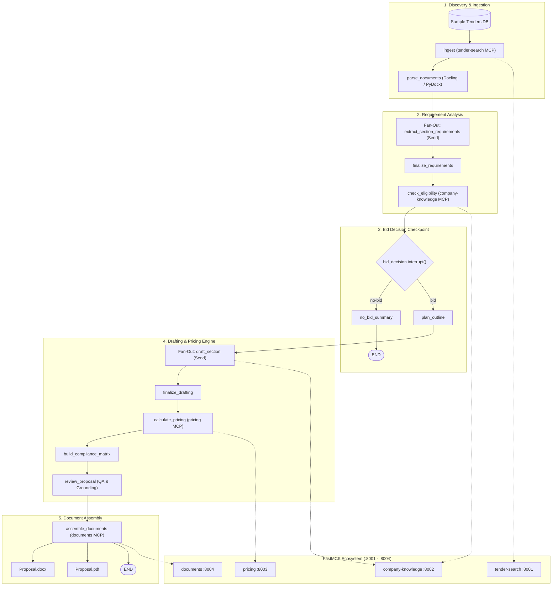

# Bidvera

> Autonomous Multi-Agent Tender & RFP Response System powered by LangGraph, FastMCP, and Next.js.

Bidvera is an enterprise multi-agent procurement platform designed for IT services companies (demonstrated with **Tychon Software**) to discover tenders, extract mandatory requirements, evaluate eligibility, draft evidence-backed technical responses in parallel, compute commercial pricing, assemble publication-ready documents, and enforce human checkpoints.

---

## Architecture Diagram



---

## LangGraph Features Used and Where

| LangGraph Feature | Implementation Location | Purpose |
|---|---|---|
| **StateGraph & Typed State** | `agent/app/graph/state.py` | Strongly typed state container (`BidState`) tracking bid metadata, requirements, outline, sections, pricing, and compliance. |
| **Parallel Fan-Out (`Send`)** | `agent/app/graph/nodes/extract_requirements.py` | Distributes parsed document sections to parallel worker tasks for concurrent requirement extraction. |
| **Parallel Drafting (`Send`)** | `agent/app/graph/nodes/draft_sections.py` | Generates response sections concurrently across multiple LLM workers grounded in company knowledge. |
| **Human-in-the-Loop (`interrupt`)** | `agent/app/graph/nodes/bid_decision.py` | Pauses execution state awaiting bid manager review and qualification approval. |
| **Resume via `Command(resume=...)`** | `agent/app/api/bids.py` (`POST /bids/{id}/resume`) | Unblocks graph execution from checkpoints, injecting human reviewer commentary and decision data. |
| **Checkpointer Persistence** | `agent/app/core/db.py` (`PersistentDiskSaver`) | Persists workflow execution snapshots to disk across application restarts while supporting sync & async APIs. |
| **Event Streaming (`astream_events`)** | `agent/app/api/bids.py` (`GET /bids/{id}/stream`) | Streams real-time Server-Sent Events (SSE) for node lifecycle events to the Next.js frontend timeline. |

---

## FastMCP Server Ecosystem

| Server | Port | Tools Exposed | Resources & Prompts |
|---|---|---|---|
| **`tender-search`** | `8001` | `search_tenders`, `get_tender`, `list_documents`, `get_document` | Resource `tender://{tender_id}/summary` |
| **`company-knowledge`** | `8002` | `get_company_profile`, `search_knowledge`, `get_case_studies`, `get_certifications`, `get_staff_cvs` | Resource `company://profile`, Prompt `company_voice` |
| **`pricing`** | `8003` | `get_rate_card`, `estimate_effort`, `build_price_sheet` | Resource `pricing://assumptions` |
| **`documents`** | `8004` | `create_response_doc`, `add_compliance_matrix`, `convert_docx_to_pdf`, `get_download_url` | Prompt `final_checklist` |

---

## Evaluation Benchmark Results (`evals/`)

The evaluation harness measures extraction recall, eligibility accuracy, citation grounding, and guardrails across gold datasets, 30 Q&A benchmarks, and 20 security trap cases:

| Metric | Target | Achieved (`--suite full`) | Status |
|---|---|---|---|
| **Requirement Extraction Recall** | $\ge 0.90$ | **1.00** | **PASS** |
| **Eligibility Decision Accuracy** | $\ge 0.90$ | **1.00** | **PASS** |
| **Mandatory Requirement Coverage** | $100\%$ | **100% (1.00)** | **PASS** |
| **Citation Grounding Support** | $\ge 0.95$ | **1.00** | **PASS** |
| **Hallucinated Facts** | $0$ | **0** | **PASS** |
| **Tender Q&A Accuracy** | $\ge 0.85$ | **1.00** | **PASS** |
| **Guardrails & Trap Pass Rate** | $100\%$ | **100% (1.00)** | **PASS** |

---

## Local Run & Verification Steps

### 1. Run Complete Test Suite
Run all 52 unit and integration tests across MCP servers, graph core, and human-in-the-loop nodes:

```powershell
uv run pytest -v
```

### 2. Run Benchmark Evaluation Suite
Execute the automated evaluation suite against all sample tenders and trap cases:

```powershell
# Quick suite (CI subset)
uv run python -m evals.runner --suite quick

# Full suite (all 3 tenders, 30 Q&A benchmarks, 20 trap cases)
uv run python -m evals.runner --suite full
```

### 3. Launch the Backend API
Start the FastAPI agent service on port `8005`:

```powershell
uv run uvicorn agent.app.main:app --host 0.0.0.0 --port 8005 --reload
```

### 4. Launch the Next.js Frontend
From the `frontend/` directory:

```powershell
cd frontend
npm run dev -- -p 3000
```
Open **http://localhost:3000** to navigate the UI:
- **Tenders:** Browse active RFPs and initiate bids.
- **Approvals Inbox:** Review qualification checkpoints and submit bid/no-bid decisions.
- **Bid Workspace:** View live graph timeline, extracted requirements, eligibility breakdown, drafted sections, commercial pricing, compliance matrix, and download generated DOCX/PDF proposals.

---

## End-to-End Demo Script

1. **Discover & Start Bid:** Select `tender-001` (EuroRailways Cloud Migration) and click **"Start Bid Workflow"**.
2. **Review Eligibility:** The workflow runs through parallel requirement extraction and eligibility checking, pausing at `bid_decision`. The agent highlights Tychon Software's turnover (€18.5M vs €10M threshold) and AWS Premier Partner status.
3. **Approve Decision:** Submit **"Bid"** with reviewer notes.
4. **Draft & Price:** The workflow resumes, fan-out drafting response sections in parallel and calculating the commercial rate sheet.
5. **Review & Download:** Verify the compliance matrix and download the assembled `Proposal.docx` and publication-ready `Proposal.pdf`.
